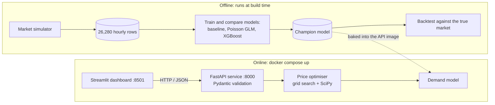
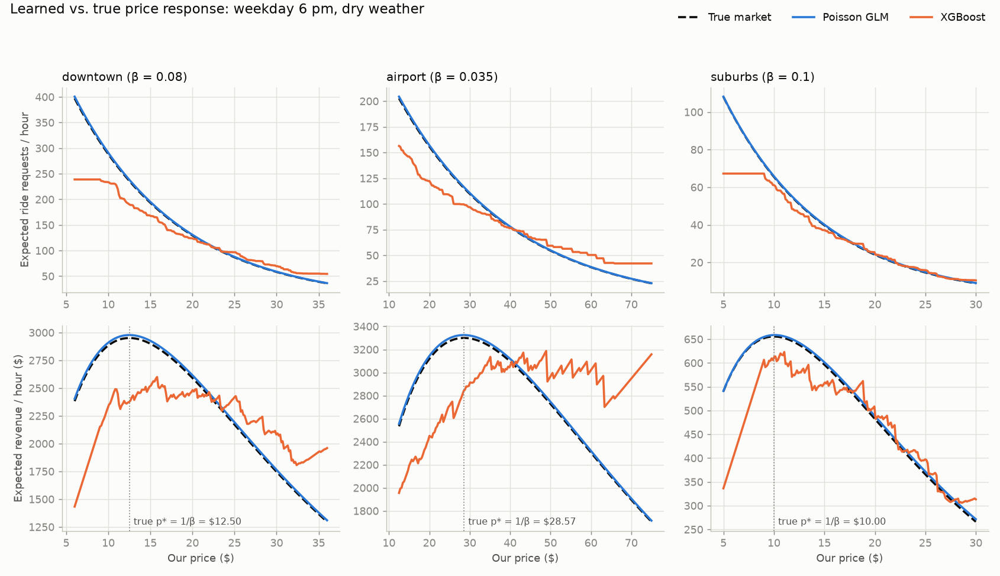
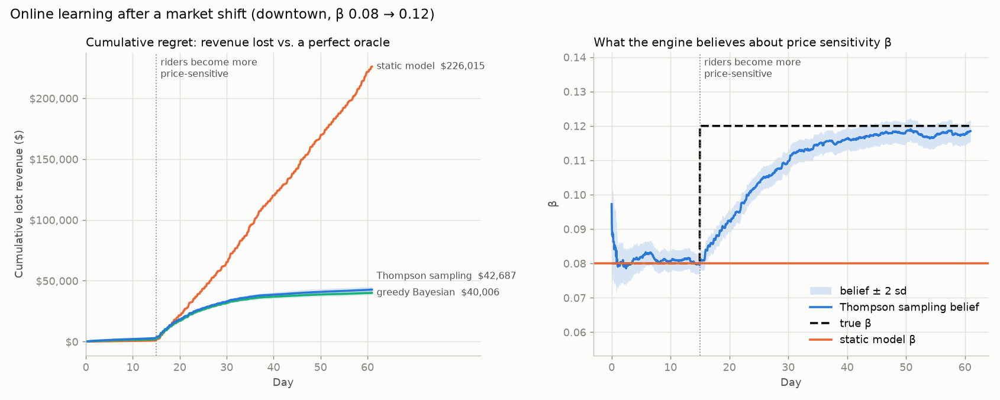
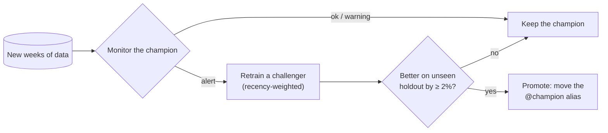

# Real-Time Dynamic Pricing & Demand Forecasting Engine

[](https://github.com/mukty32/dynamic-pricing-engine/actions/workflows/ci.yml)
[](https://dynamic-pricing-engine-nz8n.onrender.com)


An end-to-end pricing system for a ride-hailing marketplace, similar in spirit to surge
pricing. It **forecasts rider demand** with a machine-learning model, then **solves a
constrained optimisation problem** to pick the revenue-maximising price for every zone
and hour. It's served through a validated **REST API** and an **interactive dashboard**,
all containerised with Docker.

**▶ Live demo: [dynamic-pricing-engine-nz8n.onrender.com](https://dynamic-pricing-engine-nz8n.onrender.com)** (free hosting: the first visit after a while may take about a minute to wake up)

<!-- Add a dashboard screenshot: save it as docs/dashboard.png and uncomment the next line. -->
<!--  -->

## Results

Backtest on two held-out months (Nov–Dec, 4,392 zone-hours), scored against the true market:

| | Rule-based surge (before) | **This engine** | Perfect-knowledge oracle |
|---|---|---|---|
| Revenue | $2.89M | **$3.48M (+20.7%)** | $3.49M (+20.9%) |
| Riders who get a car | 71.4% | **94.9%** | 95.0% |

- The engine captures **99.8% of the theoretically achievable revenue gain.**
- Revenue **and** service quality improve together. Pricing at the market-clearing level means fewer riders request and then find no car available.
- The demand model recovers the market's hidden price sensitivity **exactly** (β̂ = 0.0800 vs true 0.080 downtown), and its forecast error (WAPE 11.0%) matches the best achievable on this data.
- **Keeps learning after deployment.** When riders suddenly became more price-sensitive, Bayesian online learning cut the lost revenue from **$226k to $43k** (keeping 97% of oracle revenue vs 85% for a frozen model).
- **Monitors itself.** A drift monitor (PSI, KS test, WAPE/bias and a Bayesian β check) catches a market change, a challenger is retrained and is promoted in the **MLflow model registry** only if it wins on unseen data. In the drift scenario, forecast error dropped from 30.9% to 13.7%, with no false alarm in the stable scenario.
- **77 automated tests, 97% coverage**, plus lint (ruff), formatting and type checks (mypy) on every push. One optimal-price API call takes about 80 ms on a laptop.

## Architecture



| Layer | Tech | Responsibility |
|---|---|---|
| Data | NumPy, pandas | Seeded simulator of a 3-zone city: time-of-day rhythms, seasonality, growth, weather, competitor and driver supply |
| Forecasting | scikit-learn, XGBoost | Demand model `D(p \| context)`, with a time-based train/test split and Poisson loss |
| Optimisation | SciPy | Revenue maximisation under supply and business-rule constraints |
| Serving | FastAPI, Pydantic, Uvicorn | Versioned REST API with strict input validation, request IDs and timing headers |
| UI | Streamlit, Altair | What-if sliders for supply, demand shocks, competitor price and rules, plus live math |
| Ops | Docker, Compose, GitHub Actions | Multi-stage images, non-root containers, health checks, CI on every push |

## The math

### 1. Demand model
Expected ride requests in a zone and hour:

$$
\mathbb{E}[D] = \underbrace{B \cdot T(h) \cdot S(t) \cdot G(t) \cdot W}_{\text{market size: zone, hour, season, growth, rain}} \cdot e^{-\beta (p - p_0)} \cdot e^{+\gamma (c - p_0)}, \qquad D \sim \text{Poisson}(\mathbb{E}[D])
$$

- $p$ is our price and $c$ the competitor's. Each extra \$1 keeps a fraction $e^{-\beta}$ of riders.
- **Price elasticity** is $\varepsilon = \frac{d\ln D}{d\ln p} = -\beta p$. Riders become *more* price-sensitive as prices rise.
- Counts are modelled as Poisson, so the models minimise **Poisson deviance**, not squared error.

### 2. Learning it from data, and the confounding trap
Raw data shows a **positive** price–demand correlation (+0.59 at the airport): the old system raised prices *because* demand was high. Controlling for time, weather and season, plus small randomised price experiments, isolates the true causal effect.

Taking logs turns the market into a linear model, so a **Poisson GLM** with the right design matrix has the market's exact shape. It recovers $\beta$ per zone directly as a coefficient:

| zone | true β | Poisson GLM | XGBoost |
|---|---|---|---|
| airport | 0.035 | **0.0350** | 0.0218 |
| downtown | 0.080 | **0.0800** | 0.0572 |
| suburbs | 0.100 | **0.0992** | 0.0783 |

XGBoost, with a monotone constraint on price, is competitive on accuracy but can't extrapolate to prices the old policy never charged. Its revenue curve becomes jagged, which would mislead an optimiser:



### 3. Price optimisation

$$
\max_{p}\; R(p) = p \cdot \min\big(D(p),\, K\big) \quad \text{s.t.} \quad p_{\text{low}} \le p \le p_{\text{high}}
$$

where $K$ = drivers × rides per driver, and the bounds come from business rules (price floor, surge cap, maximum premium over the competitor, optional price stability).

For exponential demand $D(p) = Ce^{-\beta p}$ the solution has a closed form:

$$
p^* = \operatorname{clip}\Big(\max\big(\underbrace{1/\beta}_{\text{natural peak: } R'(p)=0},\ \underbrace{\ln(C/K)/\beta}_{\text{market-clearing: } D(p)=K}\big),\ p_{\text{low}},\ p_{\text{high}}\Big)
$$

- **Surge pricing, derived:** when supply is short, the optimum is the price at which demand exactly equals capacity.
- **Global optimality:** $\ln R(p) = \ln p + \ln C - \beta p$ is concave, so $R$ is log-concave and single-peaked on an interval. The local optimum is the global one.
- **Explainability (the KKT conditions):** every price is labelled by what determined it: the natural peak, supply, or a specific business rule.
- **Demand shocks** multiply $C$ by $m$. They leave $1/\beta$ unchanged and shift the surge price by exactly $\ln(m)/\beta$.

The production solver doesn't assume the closed form, so it works with any model: a 301-point vectorised **global grid search** followed by **SciPy's bounded Brent** refinement. Tests check it against the closed form to within a cent or two.

### 4. Online learning with Thompson Sampling
A model trained on last year's data can't notice that the market changed. The engine therefore keeps a **Bayesian belief** about the demand parameters and updates it every hour from observed ride requests:

$$
y_t \sim \text{Poisson}\big(m_t\, e^{\alpha - \beta (p_t - p_0)}\big), \qquad \theta = (\alpha, \beta) \sim \mathcal{N}(\mu_0, \Sigma_0)
$$

- $m_t$ is the forecast model's prediction at the base fare. $\alpha$ corrects the overall demand level and $\beta$ is the price sensitivity. The prior is centred on the trained model.
- **Laplace approximation:** the Poisson log-likelihood is concave, so Newton's method finds the most likely $\theta$ (the MAP). The posterior is approximated by $\mathcal{N}(\hat\theta, H^{-1})$, where $H$ is the curvature of the log-posterior there.
- **Forgetting factor** $\gamma = 0.995$/hour: older observations are down-weighted by $\gamma^{\text{age}}$, so the belief can track a changing market.
- **Thompson Sampling:** each hour, draw $\tilde\theta$ from the belief and charge the closed-form optimal price for $\tilde\theta$. Uncertainty creates price variation (exploration); confidence removes it (exploitation).

**Experiment 1: market shift.** Downtown, Nov–Dec, 10 seeds. On day 15, β jumps from 0.08 to 0.12 without warning.

| strategy | revenue vs oracle | lost revenue after shift | final β belief |
|---|---|---|---|
| static model (never updates) | 84.6% | $225,136 | 0.080 |
| greedy Bayesian (updates, no exploration) | 97.3% | $38,149 | 0.119 |
| **Thompson sampling** | **97.1%** | **$39,787** | **0.120** |



**Experiment 2: why exploration matters.** When the situation is identical every hour, prices don't vary on their own. A single repeated price can't separate "fewer riders overall" (α) from "riders dislike high prices" (β). Greedy then **gets stuck on the wrong β**, a known result in the dynamic-pricing literature (den Boer & Zwart, 2014; Keskin & Zeevi, 2014):

| strategy (20 seeds, 1,500 hours) | final β belief (truth 0.12) | final price (optimum $9.60) | lost revenue |
|---|---|---|---|
| greedy Bayesian | 0.081 | $12.36 | $145,375 |
| **Thompson sampling** | **0.117** | **$9.60** | **$3,135 (46× less)** |

In the real market (experiment 1), natural variation in supply and time of day gives greedy "free" exploration, so it matches Thompson Sampling. Thompson Sampling is the strategy that stays safe when that variation disappears.

### 5. MLOps: monitoring, retraining and the model registry
`python -m pricing_engine.mlops_pipeline` runs the loop a scheduled job would run in production. Every run, metric, drift report and model version is tracked in **MLflow**.



Three kinds of drift, from "something changed" to "the model is wrong":

| check | method | severity |
|---|---|---|
| **Data drift** (inputs changed) | Population Stability Index $\text{PSI} = \sum_i (c_i - r_i)\ln\frac{c_i}{r_i}$ over reference deciles, plus a KS test | warning |
| **Performance drift** | WAPE vs the model's reference WAPE (> 1.2×), bias = actual / predicted (off by > 5%) | alert |
| **Concept drift** (β changed) | fit $y \sim \text{Poisson}(\hat y\, e^{a - b(p - p_0)})$ with the Phase 7 Bayesian learner; alert if the 95% interval for $b$ excludes 0 | alert |

Data drift alone is only a warning: the model already uses competitor price and rain as inputs, so changes there may be handled correctly. Retraining weights each row by $0.5^{\,\text{age}/14\text{ days}}$ (recent weeks count most), and the challenger must beat the champion on the newest 14 days, which neither model has seen.

Simulated Jan–Feb 2026, monitored against the champion trained on 2025:

| | stable market | drifted market (β × 1.5, competitor −15%, more rain) |
|---|---|---|
| data drift | all PSI < 0.02 | competitor price 0.21, demand 0.13, rain 0.11 (warnings) |
| forecast error (WAPE) | 11.4% (reference 11.0%) | **30.3%** → alert |
| estimated β (downtown, truth 0.080 / 0.120) | 0.081 | **0.119** → alert |
| decision | keep v1, no retraining | retrain → holdout WAPE 30.9% → **13.7%** → **promote v2** |

Browse every run, metric and model version: `mlflow ui --backend-store-uri sqlite:///mlops/mlflow.db`

## Quickstart

### Option A: Docker (one command)
Requires [Docker Desktop](https://www.docker.com/products/docker-desktop/).

```bash
docker compose up --build
```

- API docs: http://localhost:8000/docs
- Dashboard: http://localhost:8501

The API image generates the data and trains the model during the build, so there's nothing to download.

### Option C: Free cloud demo (Render)
`docker/demo.Dockerfile` packs the API and dashboard into **one** container: `deploy/run_demo.py` starts the API privately, waits for its health check, then serves the dashboard on the platform's `$PORT`. It uses about 415 MB of memory, which fits a free 512 MB instance.

1. Push this repository to GitHub.
2. On [render.com](https://render.com): **New → Blueprint**, then pick the repository. `render.yaml` configures everything.
3. Wait for the first build (it trains the model), then open the URL Render gives you.

### Option B: Local development
```bash
python -m venv .venv
.venv\Scripts\activate                     # Windows  (macOS/Linux: source .venv/bin/activate)
pip install -r requirements.txt

python -m pricing_engine.data_generation   # 1. simulate the market    -> data/raw/rides.csv
python -m pricing_engine.train             # 2. train & compare models -> models/
python -m pricing_engine.backtest          # 3. measure revenue uplift -> reports/backtest.json
python -m pricing_engine.online_experiment # 4. online-learning experiments -> reports/online_learning.json
python -m pricing_engine.mlops_pipeline    #    MLOps loop: monitor -> retrain -> promote (MLflow, in mlops/)
python -m pricing_engine.train --track     #    (optional) log a training run + register it in MLflow
uvicorn pricing_engine.api.main:app --reload   # 5. API        -> http://127.0.0.1:8000/docs
streamlit run dashboard/app.py                 # 6. dashboard  -> http://localhost:8501 (2nd terminal)
pytest --cov                                   # 77 tests + coverage report
ruff check . && ruff format --check . && mypy  # code-quality checks (the same ones CI runs)
```

## API

| Method | Endpoint | Purpose |
|---|---|---|
| GET | `/health` | Liveness and loaded model |
| GET | `/v1/zones` | Zones and base fares |
| POST | `/v1/forecast` | Expected demand at a given price |
| POST | `/v1/price` | **Revenue-maximising price** with explanation |
| POST | `/v1/price/batch` | Up to 1,000 contexts per call |
| POST | `/v1/demand-curve` | Demand and revenue across the allowed price range |

```bash
curl -X POST http://localhost:8000/v1/price -H "Content-Type: application/json" \
  -d '{"timestamp":"2025-11-18T18:00:00","zone":"downtown","competitor_price":18,"drivers_available":40}'
```

```json
{
  "price": 25.69,
  "surge_multiplier": 2.141,
  "expected_demand": 79.99,
  "expected_rides": 79.99,
  "expected_revenue": 2054.86,
  "capacity": 80.0,
  "binding_constraint": "supply",
  "revenue_uplift": 1.14,
  "model_name": "poisson_glm"
}
```
(The response is shortened here. Optional fields include `rules` to override business rules per request and `demand_multiplier` for event-driven demand shocks. Invalid input returns `422` with the offending field named.)

## Project structure

```
├── pricing_engine/
│   ├── config.py            # every simulation & path parameter (frozen dataclasses)
│   ├── data_generation.py   # market simulator + ground-truth demand function
│   ├── features.py          # feature engineering (cyclical encoding, GLM design matrix)
│   ├── model.py             # baseline, Poisson GLM, XGBoost pipelines
│   ├── train.py             # time-based split, metrics, β recovery, plots
│   ├── optimizer.py         # constrained revenue optimisation (grid + SciPy)
│   ├── backtest.py          # policy evaluation against the true market
│   ├── online_learning.py   # Bayesian (Laplace) learner + Thompson Sampling pricing
│   ├── online_experiment.py # market-shift and exploration experiments
│   ├── monitoring.py        # drift detection: PSI, KS, performance, Bayesian beta check
│   ├── tracking.py          # MLflow experiment tracking + model registry (champion alias)
│   ├── mlops_pipeline.py    # monitor -> retrain -> compare -> promote
│   └── api/                 # FastAPI app + Pydantic schemas
├── dashboard/               # Streamlit app; talks to the API over HTTP only
├── tests/                   # 77 tests: math, model, optimiser, online learning, MLOps, API, UI, full pipeline
├── docker/                  # api, dashboard and single-container demo Dockerfiles
├── deploy/run_demo.py       # runs API + dashboard in one container for free hosting
├── render.yaml              # one-click Render deployment
├── requirements/            # pinned dependencies per image
├── compose.yaml
└── .github/workflows/ci.yml
```

## Engineering decisions

- **Model choice is measured, not assumed.** A seasonal baseline, an interpretable GLM and gradient boosting compete on a time-based holdout, and the champion is picked automatically by Poisson deviance.
- **Time-based split.** Train on Jan–Oct and test on Nov–Dec. A random split would leak the future.
- **Domain knowledge as constraints.** XGBoost has monotone price constraints, and the API enforces business rules as explicit bounds.
- **Testing against known answers.** Optimiser and API tests use a fake model with a closed-form solution, so they verify the math, not just "it runs".
- **Separation of services.** The dashboard has no ML dependencies; the API is the contract.
- **Reproducibility.** Seeded simulation, pinned dependencies, and models trained inside the Docker build.
- **MLflow stays out of production.** Tracking and the registry are development/training tools (`requirements/mlops.txt`). The serving images don't install MLflow; the deployment artifact is the exported champion (`--deploy-to`).
- **Quality gates.** CI runs ruff (lint and format), mypy (types) and the test suite with a 90% coverage floor, and a pre-commit hook catches style problems before each commit.
- **Secure defaults.** Non-root containers, strict request schemas (`extra="forbid"`), request size limits, and models loaded only from trusted local files.

## Limitations & future work

- **Synthetic data.** The simulator makes exact counterfactual evaluation possible. With real data, validation would require A/B tests.
- **Static competitor.** The competitor's prices are replayed and don't react to ours. A game-theoretic or bandit-based extension would model that.
- **Deterministic capacity.** The optimiser uses $\min(D, K)$. A stochastic version would maximise $p \cdot \mathbb{E}[\min(N, K)] = p\sum_{k=0}^{K-1} P(N > k)$ for Poisson $N$.
- **MLOps loop runs on demand.** In production it would be scheduled (e.g. a weekly GitHub Actions or Airflow job) against a shared MLflow server, and a promotion would trigger a redeploy.
- **Online learning is offline-simulated.** The learner runs in a replay experiment. Wiring it into the API would need persistent state (e.g. Redis) and a feedback endpoint for observed requests.
- **Production hardening.** Next steps would be authentication and rate limiting, model monitoring and drift alerts, and a streaming feature pipeline for real-time supply data.

## License

MIT. See [LICENSE](LICENSE).
